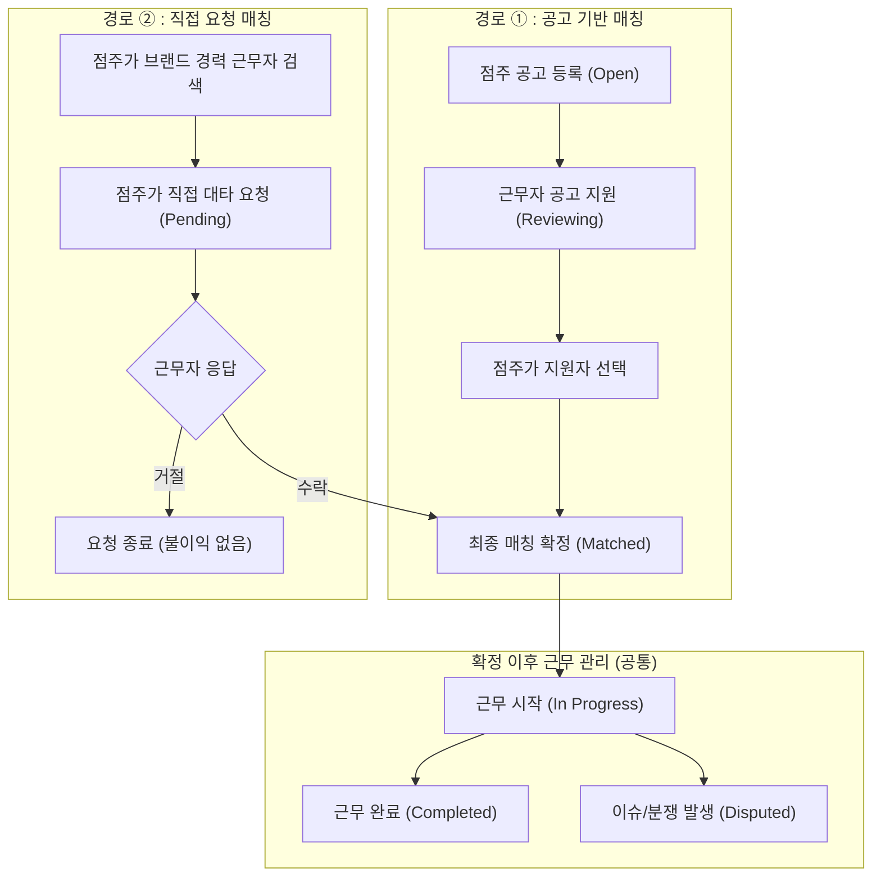

# 잡팡 (JOBPANG) 프로젝트 개발 규칙 및 설계 명세서

> **슬로건**: "오늘 일, 지금 잡자!"  
> **서비스 정의**: 갑작스러운 결근으로 인력 공백이 생긴 매장과, 같은 브랜드 근무 경험이 있는 근무자를 빠르게 연결하는 긴급 대타 매칭 플랫폼.

---

## 1. 기술 스택 (Tech Stack)

- **프론트엔드 / 프레임워크**: Next.js (App Router), TypeScript
- **스타일링**: Tailwind CSS (모바일 우선 반응형 UI)
- **앱 형태**: PWA (Progressive Web App)
- **백엔드 / 데이터베이스**: Supabase
  - PostgreSQL (Database & Functions / Triggers)
  - Supabase Auth (Authentication & Session)
  - Supabase RLS (Row Level Security - 서버 권한 강제)
  - Supabase Realtime (실시간 알림 및 상태 동기화)

---

## 2. 역할 및 권한 체계 (Roles & Permissions)

### 2.1 사용자 역할
- **점주 (`owner`)**: 매장 관리, 긴급 대타 공고 등록, 근무자 검색 및 직접 요청, 지원자 검토 및 채용 확정.
- **근무자 (`worker`)**: 브랜드 근무 이력 등록, 공고 탐색 및 지원, 점주의 직접 요청 수락/거절, 대타 근무 수행.

### 2.2 보안 및 접근 통제 원칙
- 모든 역할 기반 인가(Authorization) 및 데이터 접근 제어는 **서버(Supabase RLS 및 DB 함수)에서 강제**한다.
- 클라이언트 UI 레벨의 접근 제어는 UX 편의를 위한 보조 수단일 뿐이며, 보안의 기준으로 삼지 않는다.

---

## 3. 매칭 경로 (Matching Flows)

잡팡은 두 가지 경로로 매칭이 이루어지며, **최종 확정(Matched) 이후의 근무 관리 라이프사이클은 동일**하다.

1. **경로 ①: 공고 기반 매칭 (Job Post Flow)**
   - 점주가 긴급 대타 공고 등록 (`Open`)
   - 근무자가 공고를 탐색하고 지원 (`Reviewing`)
   - 점주가 지원자를 검토 후 채용 선택
   - 최종 매칭 확정 (`Matched`)

2. **경로 ②: 직접 요청 매칭 (Direct Request Flow)**
   - 점주가 같은 브랜드 경험이 있는 근무자 풀 검색
   - 점주가 특정 근무자에게 대타 직접 요청 발송 (`Pending`)
   - 근무자가 요청을 확인하고 수락 (`Matched`) 또는 거절
   - 근무자가 거절하더라도 근무자에게 어떠한 불이익도 부여하지 않음

3. **확정 이후 공통 라이프사이클**
   - 확정(`Matched`) 이후 근무 시작(`In Progress`), 완료(`Completed`), 취소/분쟁(`Cancelled`/`Disputed`) 절차는 두 경로 모두 동일하게 작동.

---

## 4. 상태값 및 라이프사이클 (State Lifecycle)

매칭 및 공고 건은 다음 10가지 상태값만을 사용하며, 유효한 상태 전이(State Transition)만 허용한다.

| 상태값 | 명칭 (한국어) | 설명 |
| :--- | :--- | :--- |
| `Draft` | 임시저장 | 공고가 아직 게시되지 않은 작성 중 상태 |
| `Open` | 모집 중 | 공고가 게시되어 근무자의 지원을 기다리는 상태 |
| `Reviewing` | 검토 중 | 지원자가 발생하여 점주가 지원자들을 확인/검토 중인 상태 |
| `Pending` | 수락 대기 | 점주가 특정 근무자에게 직접 대타를 요청하고 수락을 기다리는 상태 |
| `Matched` | 매칭 확정 | 점주와 근무자 간의 대타 근무가 최종 체결된 상태 |
| `In Progress` | 근무 진행 중 | 확정된 대타 근무 시간이 시작되어 근무 중인 상태 |
| `Completed` | 근무 완료 | 대타 근무가 정상적으로 종료된 상태 |
| `Cancelled` | 취소됨 | 매칭 전 공고 취소 또는 확정 후 불가피한 사유로 취소된 상태 |
| `Expired` | 기간 만료 | 근무 시작 시점까지 매칭되지 못하고 마감 시각이 경과한 상태 |
| `Disputed` | 분쟁/이의제기 | 결근, 시간 불일치, 분쟁 등 점주-근무자 간 확인이 필요한 상태 |

---

## 5. 핵심 개발 및 비즈니스 원칙 (Core Rules & Constraints)

### 5.1 경력 표시 원칙
- 근무자의 브랜드 경력은 반드시 아래 두 가지 중 하나로 명확히 구분하여 표기한다:
  - `self_declared` (자가 등록 경력): 근무자가 직접 입력한 경력
  - `store_confirmed` (매장 확인 경력): 해당 매장/점주로부터 실제 근무 사실이 확인된 경력
- **금지**: 어떠한 경우에도 **"공식 인증 경력"**이라는 문구나 단어를 사용하지 않는다.

### 5.2 개인정보 보호 (Privacy First)
- **근무자의 연락처(전화번호 등)와 정확한 상세 위치(주소지 등)는 매칭 확정(`Matched`) 이전에는 절대 비공개**로 유지한다.
- RLS 정책 및 API 반환 시에도 매칭 확정 전에는 마스킹 또는 필드 제외 처리를 서버단에서 강제한다.

### 5.3 근무자 보호 및 불이익 금지
- 점주의 직접 대타 요청에 대해 근무자가 거절하더라도 평점 하락, 노출 순위 저하 등의 **어떠한 불이익도 부과하지 않는다.**

### 5.4 서버 레벨 무결성 및 동시성 제어 (Database Constraints)
다음 검증 규칙은 클라이언트가 아닌 **반드시 데이터베이스(DB 제약조건, 트랜잭션, RLS, Trigger/Function)에서 차단**한다:
1. **시간 중복 차단**: 한 근무자가 이미 확정되었거나 진행 중인 근무 시간대와 겹치는 다른 건에 지원하거나 확정될 수 없음.
2. **이중 확정 차단**: 단일 공고 건에 대해 둘 이상의 근무자가 동시에 최종 확정될 수 없음.
3. **만료 건 확정 차단**: 마감 시한이 지났거나 이미 만료된 건(`Expired`)은 확정 상태로 전이될 수 없음.

### 5.5 감사 및 이력 관리 (Audit Logging)
- 상태값 변경(`status transition`)을 포함한 모든 중요 상태 변경은 전용 이력 테이블(History / Audit Log Table)에 변경 주체, 변경 전/후 상태, 사유, 일시를 기록하여 저장한다.

### 5.6 기능적 명시 제외 사항 (Non-Goals)
프로젝트 범위의 단순성과 본질 집중을 위해 다음 기능은 **구현하지 않는다**:
- ❌ **결제 및 정산 시스템** (매장과 근무자 간 직접 해결)
- ❌ **AI 기반 자동 매칭 알고리즘**
- ❌ **프랜차이즈 본사 전산/인증 API 연동**

### 5.7 UI / UX 원칙
- **모든 UI 문구는 한국어**로 통일한다.
- **모바일 우선(Mobile-First) 반응형 디자인** 및 PWA 환경을 최우선으로 지원한다.

---

## 6. 개발 진행 가이드라인
- 현재 단계에서는 코드 작성을 진행하지 않으며, 이 명세와 규칙을 향후 모든 DB 스키마 설계, RLS 정책 작성, 컴포넌트 및 페이지 구현의 절대적인 기준으로 삼는다.
